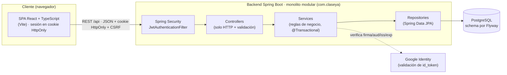
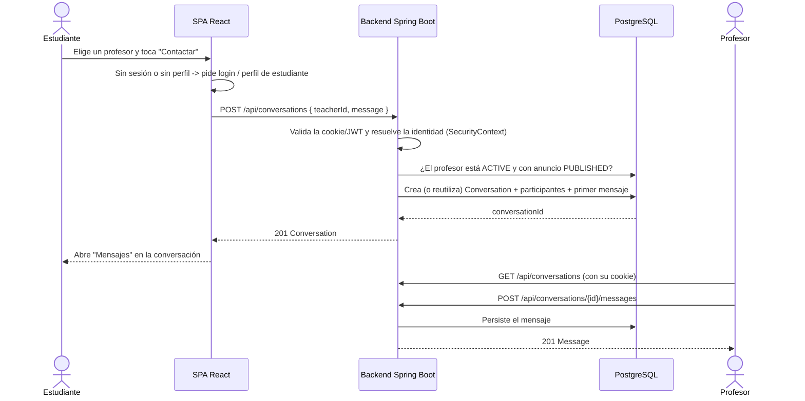

# ClaseYa

[](https://github.com/AgustinMohr/clase-ya/actions/workflows/ci.yml)

**Directorio y contacto seguro entre estudiantes y profesores particulares.**

ClaseYa ayuda a estudiantes de todas las edades —y a sus padres, madres o tutores— a encontrar
profesores particulares de la materia y la zona que necesitan. El alumno busca, compara perfiles y
**contacta** al profesor; la coordinación de fecha, hora y pago se acuerda entre las partes.

ClaseYa **no** gestiona reservas, agendas ni pagos: es un punto de encuentro con un contacto
protegido y mensajería interna, pensado para evitar exponer datos personales.

- **Estado:** en desarrollo activo. El backend, el frontend y las suites de tests funcionan; algunas
  capacidades del producto todavía no están implementadas (ver [Estado y próximos pasos](#10-estado-y-próximos-pasos)).
- **Repositorio:** https://github.com/AgustinMohr/clase-ya

---

## Índice

1. [¿Qué es ClaseYa?](#1-qué-es-claseya)
2. [Funcionalidades](#2-funcionalidades)
3. [Tecnologías](#3-tecnologías)
4. [Arquitectura y comunicación](#4-arquitectura-y-comunicación)
5. [Seguridad](#5-seguridad)
6. [Flujo de uso](#6-flujo-de-uso)
7. [Instalación y ejecución local](#7-instalación-y-ejecución-local)
8. [Pruebas y calidad](#8-pruebas-y-calidad)
9. [Estructura del proyecto](#9-estructura-del-proyecto)
10. [Estado y próximos pasos](#10-estado-y-próximos-pasos)
11. [Autor y repositorio](#11-autor-y-repositorio)

---

## 1. ¿Qué es ClaseYa?

### El problema

Encontrar un profesor particular de confianza suele resolverse en grupos de mensajería o
recomendaciones informales: poca información verificable, precios poco claros y el riesgo de dejar
datos de contacto personales en cualquier lado. Por otro lado, un docente que quiere publicar su
servicio no tiene un canal ordenado para mostrarse por materia y zona.

### La propuesta

ClaseYa reúne en un solo lugar el **anuncio del profesor** (materias, precio por hora, modalidad,
zona y disponibilidad) y un **buscador por materia**. Cuando un estudiante decide avanzar, inicia un
**contacto** que abre una **conversación interna**: las partes se escriben dentro de la plataforma
sin compartir emails, teléfonos ni direcciones.

### Público objetivo

| Usuario | Qué hace |
|---|---|
| **Visitante** | Busca por materia y explora perfiles sin cuenta. Para contactar necesita registrarse. |
| **Estudiante** | Primaria, secundaria, terciario/universidad o adulto que aprende un idioma o una herramienta. |
| **Padre / madre / tutor** | Gestiona la búsqueda y el contacto en nombre de un menor. La cuenta la maneja el adulto. |
| **Profesor** | Publica su anuncio, declara disponibilidad y responde los contactos. |
| **Administración** | Modera, mantiene el catálogo académico y revisa las credenciales de los profesores. |

### Estado actual

El proyecto se construye de forma incremental con **spec-driven development**: cada capacidad nueva
comienza como spec en `docs/specs/`, se implementa con tests y recién después se considera
terminada. El repositorio (código, specs, ADRs y docs) es la única fuente de verdad.

Hoy conviven piezas **ya implementadas** (autenticación, perfiles, búsqueda, favoritos, mensajería,
verificación documental) con piezas **en desarrollo o planificadas** (opiniones, notificaciones por
email). No es un producto terminado.

---

## 2. Funcionalidades

### Implementadas

**Descubrimiento y perfiles públicos**
- Landing con buscador por materia y acceso a las materias más buscadas.
- Búsqueda pública de profesores con filtros por **modalidad** (Online / Presencial), **calificación**
  mínima, **rango de precio por hora** y **“Solo verificados”**, con paginación.
- Tarjetas de profesor: foto, nombre, rating, ciudad, precio por hora, modalidades y materias.
- Perfil público del profesor: bio, materias, disponibilidad semanal declarada, formación,
  distintivo **Verificado / No verificado** y botón **Contactar**.

**Cuenta y acceso**
- Registro e inicio de sesión con **email + contraseña** (BCrypt), con activación por enlace de un
  solo uso enviado por email. La contraseña exige mínimo 10 caracteres, letras y números; el
  registro responde siempre `202` para no revelar si el email existe.
- Inicio de sesión con **Google OAuth** (validación de `id_token` en el backend).
- Perfil de estudiante: universidad, carrera, año y descripción.

**Para estudiantes**
- Guardar y quitar profesores de **Mis favoritos**.
- **Contactar** a un profesor: crea (o reutiliza) una conversación y opcionalmente envía el primer
  mensaje.
- Bandeja de **Mensajes**: listado de conversaciones, lectura de mensajes, envío y marca de leído.

**Para profesores**
- Área **Mi anuncio**: nombre, bio, precio, ciudad, foto y nota de disponibilidad.
- Materias que enseña, modalidades (Online / Presencial) y formación declarada.
- **Disponibilidad semanal** por franja (mañana/tarde/noche), sin solapamientos por día.
- Indicador de completitud del anuncio (**INCOMPLETE / PUBLISHED**): un anuncio se publica cuando
  tiene nombre, bio, al menos una materia, una modalidad y una disponibilidad.
- **Verificación académica**: sube documentos de respaldo (PDF/JPG/PNG), presenta credenciales y ve
  el estado y el historial de cada decisión.

**Para administración**
- CRUD del catálogo académico (**University, AcademicUnit, Career, Subject, CareerSubject**).
- Cola de verificación: ver docentes en revisión, revisar detalle, decidir
  (**VERIFIED / REJECTED / MORE_INFO_REQUIRED**) y revocar una verificación, con auditoría.

### En desarrollo o no implementadas (no las uses como si existieran)

- **Opiniones y rating**: el modelo (Review) y los agregados (`ratingAverage`/`ratingCount`) existen,
  pero todavía **no hay lógica para crear opiniones**; el perfil muestra un mensaje de “próxima fase”.
- **Activación de cuentas**: el registro por contraseña envía un enlace de un solo uso
  (`POST /api/auth/activate`); sin SMTP configurado el registro responde `503`. Las cuentas nuevas
  creadas con Google quedan `ACTIVE`.
- **Notificaciones por email**, **contraseña olvidada**, **MFA** y **refresh tokens**: no
  implementados.
- **Chat en tiempo real (WebSockets)**: no implementado (los servicios están preparados para
  reutilizarse).
- **Reservas / agenda / pagos / Calendly**: **fuera del rumbo del producto** (ver sección 10).

---

## 3. Tecnologías

> Las versiones salen de `pom.xml` y `frontend/package.json`.

### Frontend (`frontend/`)
- **React 18.3** + **TypeScript 5.6+** como lenguaje.
- **Vite 8.3** como bundler y dev server (requiere **Node 20.19+ o 22.12+**).
- **Tailwind CSS 4.3** (vía `@tailwindcss/postcss`) con tema claro/oscuro y tokens semánticos.
- Componentes propios; **lucide-react** para iconografía; **class-variance-authority** + `clsx` +
  `tailwind-merge` para variantes de componentes.
- **@react-oauth/google** para el botón de Google Identity.
- **react-router 7** (modo librería) para rutas reales, deep links y estado de búsqueda en la URL.
- Tipografías empaquetadas con **@fontsource** (Bungee para títulos, Open Sans para texto).
- **Playwright** para tests end-to-end.

### Backend (`src/`)
- **Java 17**, **Maven**, **Spring Boot 3.5.16**.
- Arquitectura de **monolito modular** (paquetes por dominio bajo `com.claseya`), con capas
  `controller → service → repository`.
- **Spring Web** (REST), **Spring Security** (JWT sin estado), **Spring Data JPA / Hibernate**,
  **Bean Validation**.
- **jjwt 0.12.6** para firmar/validar JWT y **spring-security-oauth2-jose** para la validación del
  `id_token` de Google.
- **Lombok** (opcional) y `spring-boot-devtools` (solo desarrollo, no entra en el JAR).

### Persistencia
- **PostgreSQL** como única base. El schema es propiedad de **Flyway** (migraciones `V1..V8`).
- Hibernate corre con `ddl-auto=validate`: la app **no** genera ni modifica el schema.
- **Testcontainers (postgres:16)** para los tests de integración.

### Seguridad
- Autenticación **JWT sin estado** (cookie `HttpOnly` para el navegador; Bearer solo para la suite de integración/tooling), contraseñas con **BCrypt**,
  autorización por roles (`ROLE_STUDENT` / `ROLE_TEACHER` / `ROLE_ADMIN`).
- **Google OAuth** (validación de `id_token`). CORS restringido a orígenes configurados.
- Ver [Seguridad](#5-seguridad) para el detalle y las limitaciones.

### Infraestructura y calidad
- **Dockerfile** multi-stage (build con Maven, runtime con JRE). La imagen final corre como usuario
  no-root, con `HEALTHCHECK` contra `/actuator/health` y `-XX:MaxRAMPercentage=75`.
- **TypeScript estricto + ESLint** en el frontend: `npm run lint` se ejecuta en el gate de CI.
- **Vitest + Testing Library** para lógica pura y componentes (`npm test`); Playwright queda para
  los flujos críticos.
- **Un único `package.json`**: el de `frontend/`. La raíz es Maven/Java, sin tooling Node ni un
  segundo lockfile.
- **Dependabot** para Maven (raíz: Spring/Testcontainers) y npm (`frontend`: Vite + React).
- **Tests** con Maven + Testcontainers y E2E con Playwright; scripts de PowerShell para
  test/verify/E2E/seed.
- **CI en GitHub Actions** (`.github/workflows/ci.yml`): backend `mvn clean verify` con
  Testcontainers, frontend lint/unit tests/typecheck/build/audit, E2E Playwright con PostgreSQL +
  demo seed y dependency review en pull requests. Para que sea un gate obligatorio, activar branch
  protection en `main` con los checks `Backend`, `Frontend`, `E2E` y `Dependency review`.

---

## 4. Arquitectura y comunicación

ClaseYa tiene dos componentes desplegables independientes —una **SPA** y una **API REST**— sobre una
única base **PostgreSQL**.



### Responsabilidades

- **Frontend (SPA):** experiencia de usuario, estado de sesión y llamadas a la API. No aplica reglas
  de negocio ni de visibilidad: esas viven en el backend. La sesión viaja en una cookie `HttpOnly`
  (`credentials: 'include'`); el JWT nunca es accesible desde JavaScript. Los métodos unsafe envían
  `X-XSRF-TOKEN` con un token pedido a `/api/auth/csrf`.
- **Backend (API REST):** expone `/api/**`, aplica seguridad, valida entradas, ejecuta las reglas de
  negocio y devuelve **DTOs (records)**, nunca entidades JPA.

### Cómo se comunican

- **En desarrollo:** el dev server de Vite hace de **proxy** de `/api` hacia `http://localhost:8080`,
  así que no hay CORS en local. La SPA usa una URL relativa (`api.ts`).
- **En producción:** la SPA apunta al backend con `VITE_API_URL` y el backend permite ese origen vía
  `FRONTEND_URL` (CORS). El hosting del frontend debe reescribir las rutas desconocidas a
  `index.html` (fallback SPA); sin eso, un refresh en `/profesores/:id` devuelve 404 del servidor.
- El contrato es **REST + JSON**. Las respuestas de listado reutilizan una forma de página genérica
  (`content / page / size / totalElements / totalPages`).

### Cómo se organiza el backend

Dentro de cada módulo, el flujo es siempre el mismo:

```
HTTP request
  → Cadena de filtros de Spring Security (JWT sin estado)
        JwtAuthenticationFilter: lee la cookie CLASEYA_SESSION (o "Authorization: Bearer"),
        valida firma + expiración, recarga el usuario y exige status = ACTIVE
  → Controller  (mapea HTTP + @Valid)
  → Service     (@Transactional; valida ownership e invariantes)
  → Repository  (Spring Data JPA / JPQL) → PostgreSQL
  → Respuesta: records DTO
```

La identidad de quien actúa **siempre** se resuelve desde el `SecurityContext` (`security.CurrentUser`);
el cliente nunca envía `userId`/`studentId`/`senderId`/`participantIds` para decidir quién actúa.

### Manejo de errores y respuestas HTTP

Todas las excepciones se traducen a una forma uniforme `ApiError`:

```json
{ "timestamp": "...", "status": 404, "error": "Not Found", "message": "...", "path": "/api/..." }
```

| Código | Cuándo |
|---|---|
| **400** | Validación, formato o parámetro inválido |
| **401** | No autenticado / credenciales inválidas (`RestAuthenticationEntryPoint`) |
| **403** | Rol insuficiente (`RestAccessDeniedHandler`) |
| **404** | Recurso inexistente o **ajeno** (no se revela su existencia) |
| **405** | Método no permitido |
| **409** | Conflicto (duplicado, transición inválida, recurso protegido) |
| **413** | Archivo de evidencia mayor a 10 MB |

Nunca se filtran stack traces ni SQL al cliente.

### Flujo representativo: contactar a un profesor



---

## 5. Seguridad

> Solo se documentan mecanismos verificables en `SecurityConfig`, el paquete `security` y las specs.
> Usar JWT **no** hace al sistema seguro por sí solo: estas son las medidas concretas y sus límites.

### Autenticación y sesión
- **JWT sin estado**: no hay sesión HTTP de servidor (`SessionCreationPolicy.STATELESS`). El token
  viaja en la cookie `CLASEYA_SESSION` (`HttpOnly`/`Secure`/`SameSite`) para el navegador; la suite
  de integración puede usar `Authorization: Bearer`.
- El filtro **recarga el usuario en cada request**, así que una cuenta deshabilitada deja de operar
  de inmediato, incluso con un token todavía válido.
- **Contraseñas**: solo BCrypt (`password_hash`); nunca se guardan, loguean ni devuelven en texto.
- **Google OAuth**: el backend valida `id_token` (firma/JWKS, `iss`, `aud`, `exp`, `email_verified`)
  y vincula por `google_sub`. No se persisten tokens de Google.
- **Fail-fast de configuración**: fuera del perfil `local`, el backend **no arranca** si `JWT_SECRET`
  es el default de desarrollo, está vacío o tiene menos de 32 bytes (HS256).

### Autorización y protección de recursos
- Roles `ROLE_STUDENT` / `ROLE_TEACHER` / `ROLE_ADMIN` con **un único punto de mapeo**
  (`AppUserDetails`). `ADMIN` no puede auto-registrarse.
- Rutas protegidas por rol en la cadena de filtros (catálogo académico: lectura pública, escritura
  solo `ADMIN`; `/api/favorites/**` solo `STUDENT`; `/api/teachers/me/**` `TEACHER`/`ADMIN`;
  `/api/admin/**` solo `ADMIN`; etc.).
- **Ownership desde el contexto**: los recursos personales (`/me`, favoritos, conversaciones) se
  resuelven por el usuario autenticado, nunca por un id enviado por el cliente. Quien no participa
  de una conversación recibe **404**.
- **Visibilidad pública** aplicada en backend: solo se muestran profesores `ACTIVE` con anuncio
  publicado (`PUBLISHED`); el resto se comporta como 404. El filtro “Solo verificados” acota además a
  `verification_status = VERIFIED`. La regla no se delega al frontend.
- **Evidencia de verificación**: un documento de otro docente responde **404**; los binarios nunca
  viajan en JSON y se sirven como `attachment`.

### Validación de entradas
- **Bean Validation** en los DTOs de entrada y validación de negocio en los servicios.
- Paginación y orden con **whitelist** (nunca columnas arbitrarias del cliente); límites de tamaño
  de página (400 fuera de rango).
- Archivos de verificación validados por **magic bytes** (PDF/JPG/PNG), no por extensión, con
  **SHA-256** y nombre saneado.

### Protección de credenciales y secretos
- Los secretos vienen de **variables de entorno** (`DB_*`, `JWT_SECRET`, `JWT_EXPIRATION`,
  `FRONTEND_URL`, `GOOGLE_CLIENT_ID`). `application.yml` contiene **defaults solo de desarrollo**,
  que no son secretos de producción.
- Los DTOs públicos y personales **no** incluyen emails de terceros, direcciones, coordenadas
  exactas, tokens ni hashes.

### CORS, errores y otras medidas
- **CORS restringido** a `cors.allowed-origins` (`FRONTEND_URL`), sin wildcard, con los headers
  `Authorization` y `Content-Type`.
- **CSRF activo para cookies**: los requests unsafe autenticados por cookie exigen
  `X-XSRF-TOKEN` (doble submit); los requests con Bearer están exentos porque un sitio cross-site
  no puede poner ese header. La SPA pide un token nuevo antes de cada escritura.
- **Anti-enumeración**: los fallos de login devuelven un único mensaje genérico.
- **Rate limiting (RATE-001)**: límites por IP para login/registro/Google y por usuario para contacto,
  mensajes y subida de evidencia; respuesta `429` con `Retry-After`. Es **por instancia** (sin Redis)
  y las claves se guardan hasheadas, nunca como IP/email crudos. Ver `docs/architecture/security.md`.
- **Health check**: `GET /actuator/health` es público y devuelve solo el estado (`{"status":"UP"}`);
  no expone detalles ni métricas. Es la sonda que usa el despliegue.
- Errores estandarizados como `ApiError`, sin trazas ni SQL.

### Limitaciones y pendientes (no resueltas en el código)
- **Rate limiting distribuido**: el limitador es en memoria; con varias instancias el límite efectivo
  se multiplica. Migrar a Redis requiere una spec/ADR futura.
- Sin **refresh tokens**, recuperación de contraseña ni cambio de email.
- Sin MFA ni otros proveedores sociales.

---

## 6. Flujo de uso

Así vive ClaseYa una persona, sin conocer el código:

1. **Entra a la plataforma.** Abre el sitio en el navegador. No hace falta cuenta para mirar: puede
   buscar y ver perfiles como visitante.
2. **Busca o descubre profesores.** Escribe una materia en el buscador (con sugerencias) o toca una
   de las materias populares. Puede afinar por modalidad (Online / Presencial), calificación, rango
   de precio y “Solo verificados”.
3. **Consulta perfiles.** De cada profesor ve la tarjeta con foto, rating, zona, precio por hora y
   modalidades. Al abrir el perfil encuentra la bio, las materias, la **disponibilidad semanal**
   declarada, la formación y si está **Verificado**. El precio y el estado de verificación son
   referencias, no una garantía.
4. **Toma la decisión de contactar.** Si toca **Contactar**, se le pide **iniciar sesión** (con
   Google o email y contraseña). Si es estudiante y todavía no completó su perfil, se le pide
   completarlo: sin perfil no se puede contactar (la API responde 409).
5. **Contacta dentro de la plataforma.** Al confirmar, ClaseYa crea (o reutiliza) una **conversación
   interna** y lleva al usuario a **Mensajes**. A partir de ahí, las partes se escriben por ese canal:
   no hacen falta emails ni teléfonos y ninguno queda expuesto.
6. **Qué pasa adentro y qué queda afuera.**
   - **Dentro:** registro/acceso, búsqueda, perfiles, favoritos, verificación documental del profesor
     y **mensajería** entre las partes.
   - **Fuera:** acordar el día, la hora, el lugar y el **pago**. ClaseYa no reserva, no cobra y no
     agenda: solo pone en contacto.

---

## 7. Instalación y ejecución local

### Prerrequisitos

| Herramienta | Versión |
|---|---|
| **Java JDK** | 17 |
| **Maven** | 3.9+ (o el wrapper si estuviera presente) |
| **Node.js + npm** | 20.19+ o 22.12+ (lo exige Vite 8) |
| **Docker Desktop** | Para la base PostgreSQL local y para los tests de integración (Testcontainers) |

### Variables de entorno (backend)

El backend las lee de entorno; los valores por defecto de `application.yml` son **solo de
desarrollo**:

| Variable | Default (dev) | Para qué |
|---|---|---|
| `DB_URL` | `jdbc:postgresql://localhost:5432/claseya` | Conexión JDBC |
| `DB_USERNAME` / `DB_PASSWORD` | `claseya` / `claseya` | Credenciales de la base |
| `JWT_SECRET` | placeholder de dev | Clave de firma JWT. **Obligatoria** y ≥32 bytes fuera de `local` |
| `JWT_EXPIRATION` | `3600` | Vida del token (segundos) |
| `COOKIE_SECURE` | `true` | Flag `Secure` de las cookies de sesión/CSRF. `false` **solo** para HTTP local |
| `COOKIE_SAME_SITE` | `Lax` | `Lax` para SPA/API same-site; `None` (+ `Secure`) si el API está en otro sitio |
| `FRONTEND_URL` | `http://localhost:3000,http://localhost:5173` | Orígenes permitidos por CORS (lista separada por comas) |
| `GOOGLE_CLIENT_ID` | *(vacío)* | Client ID de Google; necesario para el login con Google |
| `GOOGLE_ISSUER` | `https://accounts.google.com` | Emisor esperado del `id_token` |
| `DEMO_SEED` | `false` | Sembrar el dataset demo al arrancar (opt-in) |
| `PORT` | `8080` | Puerto del servidor |
| `RATE_LIMIT_ENABLED` | `true` | Activa/desactiva el limitador (RATE-001) |
| `APP_BASE_URL` | `http://localhost:5173` | Origen público de la SPA; base de los enlaces de activación |
| `AUTH_ACTIVATION_TTL` | `PT24H` | Vigencia del token de activación |
| `AUTH_LOG_ACTIVATION_LINKS` | `false` | **Solo desarrollo**: escribe el enlace en el log en lugar de enviarlo |
| `MAIL_HOST` / `MAIL_PORT` | *(vacío)* / `587` | SMTP del email de activación; sin host el registro responde `503` |
| `MAIL_USERNAME` / `MAIL_PASSWORD` | *(vacío)* | Credenciales SMTP |
| `MAIL_FROM` | `no-reply@claseya.app` | Remitente del email de activación |
| `RATE_LIMIT_TRUST_FORWARDED_HEADERS` | `false` | Confía en `X-Forwarded-For`/`Forwarded` solo detrás de un proxy confiable |
| `LOGGING_STRUCTURED_FORMAT_CONSOLE` | *(vacío)* | `ecs` para logs JSON en producción; el `requestId` viaja en el MDC |

Los límites de cada scope (`RATE_LIMIT_LOGIN_IP_LIMIT`, `RATE_LIMIT_LOGIN_ACCOUNT_LIMIT`,
`RATE_LIMIT_CONTACT_USER_LIMIT`, etc.) tienen defaults en `application.yml` y se pueden sobrescribir
por entorno. Ver `docs/architecture/security.md` y el ADR-017.

### Base de datos local (Docker)

El repositorio incluye `docker-compose.yml` con un `postgres:16`:

```powershell
docker compose up -d postgres
docker compose down          # detiene; los datos quedan en el volumen
```

Si ya tenías el contenedor creado a mano (`claseya-pg`), podés seguir usándolo:

```powershell
docker start claseya-pg
```

No mezcles ambos: el compose usa el mismo nombre de contenedor y un volumen propio.

Las migraciones de Flyway se aplican automáticamente al levantar el backend.

### Backend

```powershell
# Asegurate de NO tener DB_URL / DB_USERNAME / DB_PASSWORD seteadas apuntando a otra base.
mvn spring-boot:run "-Dspring-boot.run.profiles=local" "-Dspring-boot.run.jvmArguments=-Duser.timezone=UTC"
```

- El perfil `local` activa la configuración de desarrollo (`application-local.yml`, **gitignoreado**)
  y el seed demo. Para un clon nuevo copiá la plantilla versionada:
  `Copy-Item src/main/resources/application-local.example.yml src/main/resources/application-local.yml`.
  Si no existe, el backend arranca igual, sin seed y sin client id de Google.
- El flag `-Duser.timezone=UTC` es obligatorio en Windows (evita el error de zona horaria de Postgres).
- Verificación rápida: `http://localhost:8080/actuator/health` y `http://localhost:8080/api/teachers`.

### Frontend

```powershell
cd frontend
npm install
Copy-Item .env.example .env      # completá VITE_GOOGLE_CLIENT_ID para habilitar el login con Google
npm run dev                       # http://localhost:5173
npm run lint                      # ESLint (TypeScript + hooks)
npm test                          # Vitest: lógica pura y componentes (sin Docker)
npm run build                     # tsc estricto + build + chequeo de CSP
```

En local **no** se define `VITE_API_URL`: el proxy de Vite envía `/api` a `http://localhost:8080`, así
que no hay CORS. Variables del frontend:

| Variable | Para qué |
|---|---|
| `VITE_GOOGLE_CLIENT_ID` | Client ID de Google (debe ser **el mismo** que `GOOGLE_CLIENT_ID` del backend) |
| `VITE_API_URL` | Origen del backend; **vacío** en local y en Vercel con el rewrite de `ADR-022` |

### Google OAuth (configuración externa necesaria)

El login con Google requiere un **OAuth Client ID** de tipo *Web application* en Google Cloud
Console. No hace falta `client_secret` (el SPA no lo usa). El mismo client id debe configurarse en el
backend (`GOOGLE_CLIENT_ID`) y en el frontend (`VITE_GOOGLE_CLIENT_ID`).

En **Authorized JavaScript origins** deben figurar, exactamente como los ve el navegador:

- `http://localhost:5173` (Vite en desarrollo).
- `http://127.0.0.1:5173` solo si abrís la app por la IP: Google lo trata como otro origen.
- El origen de producción (por ejemplo `https://claseya.example`), sin barra final.

Si falta el origen, Google responde `Error 400: origin_mismatch`. La SPA muestra el origen actual y
esa ruta de configuración junto al botón, para que el valor a registrar no sea una adivinanza.

### Despliegue en Vercel (SPA + API en el mismo origen)

El SPA y el API tienen que compartir el origen público. Si el SPA llama al backend en otro dominio,
la cookie CSRF (`SameSite=Lax`) no viaja entre sitios y el login responde `403 Access denied`
(ver `ADR-022`).

`frontend/vercel.json` ya proxea `/api/*` al backend:

- En Vercel, definí `BACKEND_URL` con el origen del backend, **sin barra final** (por ejemplo
  `https://claseya-api.onrender.com`).
- Quitá `VITE_API_URL` del proyecto de Vercel (si queda, el SPA vuelve a llamar al backend
  cross-site) y redeployá: es una variable de build.
- En el backend: `FRONTEND_URL=https://<proyecto>.vercel.app` (exacto, sin barra final ni espacios),
  `COOKIE_SAME_SITE=Lax`, `COOKIE_SECURE=true` y `RATE_LIMIT_TRUST_FORWARDED_HEADERS=true` (Vercel
  sobrescribe `X-Forwarded-For`; sin esto todos los usuarios comparten el bucket de rate limit).
- Agregá `https://<proyecto>.vercel.app` a *Authorized JavaScript origins* de Google.

Si el proyecto de Vercel usa la raíz del repo como root (en lugar de `frontend/`), mové
`vercel.json` a la raíz y agregá `"buildCommand": "npm --prefix frontend run build"` y
`"outputDirectory": "frontend/dist"`.

**Subidas de evidencia:** los archivos de hasta 10 MB pasan por Vercel. Verificá ese flujo después
del cambio. Si lo corta (413), las salidas son: servir SPA y API en subdominios del mismo sitio
(`app.example.com` + `api.example.com`, donde `SameSite=Lax` funciona sin proxy), bajar el tope de
archivo o migrar la evidencia a object storage (`STOR-01`). Una subida directa cross-site no sirve:
perdería la cookie de sesión.

### Datos de demo (solo desarrollo)

Con el perfil `local`, el backend siembra el dataset demo al arrancar (`app.demo-seed.enabled=true`),
ejecutando `db/seed/demo-data.sql` (idempotente y no destructivo). Contraseña de las cuentas demo:
`Password123` (por ejemplo `admin@claseya.dev`, `profe01..profe55@claseya.dev`,
`alumno01..alumno35@claseya.dev`). También se puede sembrar sin levantar la app:

```powershell
scripts\seed-demo.ps1   # requiere el contenedor claseya-pg corriendo
```

---

## 8. Pruebas y calidad

### Backend

- **Unitarios** (sin Spring ni base): p. ej. `JwtServiceTest`, `JwtSecretValidatorTest`,
  `GoogleIdTokenVerifierTest`, `VerificationAggregatorTest`, `AvailabilityValidationTest`.
- **Integración** (`@SpringBootTest` + MockMvc + **Testcontainers PostgreSQL 16**): stack completo
  —auth, OAuth, catálogo académico, perfiles, búsqueda de profesores, tarjetas, favoritos,
  mensajería, disponibilidad y el circuito de verificación—. Ejecutan contra una base real y
  verifican casos de error, ownership (IDOR), roles y visibilidad.

```powershell
mvn -B clean test                              # suite completa (requiere Docker Desktop activo)
mvn -B test -Dtest=AuthIntegrationTest         # una clase
scripts/test.ps1                               # preflight de Docker + mvn -B clean test
scripts/verify.ps1                             # verificación reproducible (reporta PASS/FAIL)
```

> El repositorio incluye el **Maven Wrapper** (`mvnw`/`mvnw.cmd`, Maven 3.9.16): usalo si no tenés
> Maven instalado (`.\mvnw.cmd -B clean test`).

### Frontend

- **Build/chequeo de tipos:** `npm run build` (ejecuta `tsc` + `vite build`).
- **End-to-end (Playwright):** levanta el stack real (backend con perfil `local` + Vite) sobre la base
  demo y recorre flujos críticos (sesión, búsqueda, perfil de profesor, favoritos, mensajería,
  “Mi anuncio”, transparencia de datos y routing/deep links).

```powershell
# desde la raíz; requiere Docker y el contenedor claseya-pg
npx playwright install chromium   # primera vez
scripts\e2e.ps1                   # levanta su propio backend (determinista)
scripts\e2e.ps1 -ReuseBackend     # reutiliza un backend ya levantado (más rápido)
```

> No se afirman valores de cobertura: el repositorio no publica un porcentaje medido. La referencia
> verificable es que la suite de integración y los E2E existan y pasen con Docker activo.

---

## 9. Estructura del proyecto

```
clase-ya/
├─ src/main/java/com/claseya/        # Backend (monolito modular)
│  ├─ model/                 Entidades JPA + enums (no depende de nada)
│  ├─ common/               ApiError, GlobalExceptionHandler, excepciones tipadas, utilidades
│  ├─ user/                 UserRepository (lookup de identidad compartido)
│  ├─ security/             Cadena de filtros, JwtService, JwtAuthenticationFilter,
│  │                        AppUserDetails, CurrentUser, JwtSecretValidator, handlers 401/403
│  ├─ auth/                 Registro / login (BCrypt + AuthenticationManager)
│  ├─ oauth/                Login con Google (validación de id_token)
│  ├─ academic/             Catálogo: University, AcademicUnit, Career, Subject, CareerSubject
│  ├─ student/              StudentProfile
│  ├─ teacher/              Perfil, materias, modalidades, formación, búsqueda y detalle públicos
│  ├─ availability/         Disponibilidad semanal declarada del profesor
│  ├─ favorite/             Favoritos de estudiantes
│  ├─ messaging/            Conversaciones, participantes, mensajes y estado de lectura
│  ├─ verification/         Circuito de verificación académica (profesor + admin)
│  ├─ bootstrap/            DemoDataSeeder (solo desarrollo)
├─ src/main/resources/
│  ├─ application.yml        Configuración (defaults solo de desarrollo)
│  ├─ db/migration/          Migraciones Flyway V1..V8 (schema)
│  └─ db/seed/demo-data.sql  Dataset demo (idempotente, solo desarrollo)
├─ src/test/java/com/claseya/  Tests unitarios e integración (Testcontainers)
├─ frontend/                 SPA React + TypeScript + Vite
│  ├─ src/api.ts             Cliente de la API REST (tipado)
│  ├─ src/auth/              Contexto de sesión (cookie HttpOnly + /api/auth/me)
│  ├─ src/pages/             Landing, Búsqueda, Perfil de profesor, Mensajes, Mi anuncio
│  ├─ src/components/        Componentes de UI y de profesor
│  └─ tests/                 Suite E2E de Playwright
├─ docs/                     Specs, ADRs, arquitectura, seguridad, testing y guías
├─ scripts/                  test.ps1 · verify.ps1 · e2e.ps1 · seed-demo.ps1
├─ Dockerfile                Imagen del backend (multi-stage)
└─ AGENTS.md                 Reglas permanentes de desarrollo
```

Módulos hoja: `model` y `common`. El resto puede usar `model`, `common`, `security` y `user`. Existe
reutilización deliberada de helpers de presentación entre módulos (favoritos y mensajería reutilizan
`TeacherSummaryAssembler` y la forma de página genérica), siempre a nivel de **servicio/DTO**.

---

## 10. Estado y próximos pasos

### Implementado
- Autenticación (email/contraseña + Google OAuth) y autorización por roles.
- Catálogo académico (CRUD admin) y perfiles de estudiante y profesor.
- Publicación del anuncio (“Mi anuncio”) con materias, modalidades, formación y disponibilidad.
- Búsqueda pública con filtros, orden estable y paginación; perfil público con distintivo de
  verificación.
- Favoritos y mensajería interna (con contacto que abre conversación).
- Circuito de verificación académica con evidencia documental, auditoría y decisiones de admin.

### En desarrollo
- **Opiniones y rating** (modelo listo, sin lógica de creación todavía).
- **Flujo de activación de cuentas** y notificaciones por email.
- Chat en tiempo real (WebSockets); el rate limiting básico ya está implementado (RATE-001).

### Fuera del alcance actual (documentado, no descartado a futuro)
- **Reservas, agenda online y Calendly** quedaron **deprecadas como rumbo de producto**; las specs y
  documentos se conservan como historia.
- **Pagos** procesados por la plataforma (el acuerdo es entre las partes).
- Búsqueda full-text (Elasticsearch), caché (Redis) y PostGIS: solo si el catálogo o la geografía lo
  exigen; hoy todo es PostgreSQL.

---

## 11. Autor y repositorio

- **Repositorio:** https://github.com/AgustinMohr/clase-ya
- **Autor:** Agustin Mohr ([@AgustinMohr](https://github.com/AgustinMohr)).

ClaseYa es un proyecto **personal y académico** de desarrollo full-stack: nace como un caso de
estudio para llevar a la práctica, de punta a punta, un producto real —modelo de dominio, seguridad,
base de datos versionada con Flyway, arquitectura modular, tests de integración y E2E— guiado por un
flujo de trabajo de **spec-driven development**.

**Licencia:** el repositorio no declara una licencia por el momento. Si necesitás usarlo, contactá al
autor.

---

**Documentación adicional:** `AGENTS.md` (reglas de desarrollo), `docs/product/` (producto),
`docs/architecture/` (arquitectura, seguridad, decisiones/ADRs) y `docs/specs/` (specs activas).
