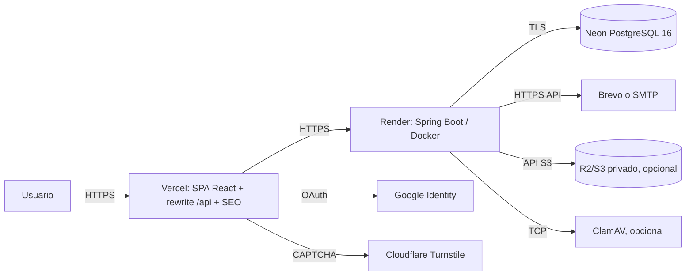

# Informe de infraestructura de producción — ClaseYa

- **Fecha:** 2026-11-13
- **Alcance:** análisis de la configuración de despliegue existente y diseño del procedimiento para llevar ClaseYa a producción.
- **Modo:** read-only. No se modificaron configuraciones, no se accedió a paneles de proveedores y no se desplegó nada.
- **Presupuesto objetivo:** USD 0–20 mensuales.
- **Lanzamiento inicial:** Santa Fe, Argentina.
- **Fuente de verdad:** código, `README.md`, specs, ADRs y auditorías del repositorio.
- **Nota:** este informe complementa `docs/audits/2026-11-13-production-readiness.md`; no reemplaza esa auditoría.

---

## 1. Resumen ejecutivo

El código ya contiene los controles necesarios para producción: Flyway con `ddl-auto=validate`,
health público sin detalles, cookies `HttpOnly`/`Secure`, CSRF, CORS sin wildcard, validadores de
arranque, cuarentena de datos demo, outbox con reintentos y almacenamiento de evidencia PostgreSQL o
S3/R2. El problema no es el diseño: es que **la configuración real de producción no está verificada ni
versionada** y hay bloqueantes operativos heredados.

Arquitectura detectada:

| Componente | Proveedor detectado | Evidencia | Estado |
|---|---|---|---|
| SPA + SEO + proxy `/api` | Vercel | `.vercel/repo.json`, `frontend/vercel.json`, `frontend/middleware.ts` | Vinculado localmente |
| Backend Spring Boot | Render (inferido) | Comentarios del `Dockerfile`, README y auditoría | **No hay `render.yaml`; confirmar** |
| PostgreSQL 16 | Neon | `.neon` con rama `production`, README y auditoría | Vinculado |
| Email | Brevo o SMTP | `application.yml`, `NOTIF-001` | Proveedor real **sin confirmar** |
| Evidencia | PostgreSQL (default) o S3/R2 | `application.yml`, `S3DocumentStorage` | Decisión **sin confirmar** |
| Antivirus | ClamAV opcional | `ClamAVDocumentScanner`, `SCAN_ENABLED=false` por defecto | **No desplegado** |
| CAPTCHA | Cloudflare Turnstile | `application.yml`, `SEC-003` | Credenciales **sin confirmar** |
| Login social | Google OAuth | `application.yml`, `ADR-015` | Client ID **sin confirmar** |
| Observabilidad | Solo logs/Actuator | `SecurityConfig`, `application.yml` | Sin Sentry ni uptime monitor |

**Recomendación:** mantener el stack detectado (Vercel + Render + Neon) con despliegue same-origin,
Render Starter si se quiere evitar el spin-down, Neon Free, Brevo, Cloudflare R2 y un monitor externo.
El costo realista queda en **USD 7–14/mes** si se evita Vercel Pro y Neon Launch. Si Vercel exige
plan Pro por uso comercial, el presupuesto se supera solo con ese plan.

**Bloqueantes que deben cerrarse antes de abrir tráfico:**

1. Rotar la credencial de Neon que estuvo en `.env.local` y sacarla del workspace.
2. Promover la release a `main`; la rama actual es una rama de trabajo, no la rama de producción.
3. Limpiar las cuentas demo `@claseya.dev` y confirmar `DEMO_SEED=false`.
4. Configurar y verificar todas las variables de producción; el backend falla al arrancar si faltan.
5. Verificar backups/PITR de Neon y hacer una prueba de restauración.
6. Decidir almacenamiento y escaneo de evidencia; PostgreSQL por defecto no es la mejor opción.
7. Confirmar el límite de body de Vercel para subidas de hasta 10 MB.
8. Confirmar que el `HEALTHCHECK` del contenedor puede ejecutar `curl` en la imagen real.

---

## 2. Arquitectura actual detectada



Puntos verificados:

- El SPA no llama al backend cross-site: `frontend/src/api.ts:393` deja `API_BASE` vacío y usa rutas
  relativas `/api`.
- `frontend/vercel.json:8-25` reescribe `/api/*`, `/sitemap.xml` y `/sitemaps/*` hacia
  `${BACKEND_URL}` y hace fallback SPA a `/index.html`.
- `frontend/middleware.ts` intercepta solo `/`, `/buscar` y `/profesores/*` para el prerender SEO.
- El backend escucha `${PORT:8080}` (`application.yml:1-3`), lo que permite Render.
- El `Dockerfile` es multi-stage, corre como usuario no-root y declara `HEALTHCHECK` contra
  `/actuator/health` (`Dockerfile:19-39`).
- No hay `render.yaml`, `fly.toml`, `railway.json` ni workflow de deploy en `.github/workflows/`.
  La configuración de Render y Vercel se administra fuera del repositorio.

---

## 3. Arquitectura de producción recomendada

### 3.1 Topología

- **Un solo origen público** para SPA y API: `https://<dominio>`.
- Vercel sirve el SPA, el prerender SEO y proxea `/api/*` al backend.
- Render ejecuta el backend Docker en una única instancia.
- Neon aloja PostgreSQL 16 en la rama `production`.
- Brevo entrega los emails por HTTPS (Render Free bloquea SMTP saliente).
- Cloudflare R2 guarda la evidencia privada; el backend es el único que la lee.
- ClamAV corre como servicio TCP separado **solo si** se decide escanear evidencia.
- Un monitor externo consulta `/actuator/health` y alerta por estado distinto de `UP`.
- Logs a stdout, recolectados por Render/Vercel; sin archivos locales.

### 3.2 Decisiones que no se pueden inventar

| Decisión | Opción recomendada | Alternativa | Consecuencia |
|---|---|---|---|
| Plan Vercel | Hobby si el proyecto califica como no comercial | Pro | Pro cuesta aproximadamente USD 20/mes y consume todo el presupuesto |
| Plan Render | Starter pago | Free | Free duerme por inactividad, demora el arranque y frena el worker del outbox |
| Plan Neon | Free | Launch | Launch cuesta aproximadamente USD 19/mes y supera el presupuesto |
| Evidencia | R2 privado | PostgreSQL `bytea` | PostgreSQL consume storage/backups de Neon y mezcla PDFs con datos relacionales |
| Escaneo | ClamAV externo | `ALLOW_UNSCANNED_EVIDENCE=true` | Sin escáner, la evidencia se guarda sin analizar y queda declarada como `UNSCANNED` |
| Email | Brevo | SMTP | SMTP no funciona en Render Free; en Render pago requiere remitente y puerto válidos |

---

## 4. Verificación por punto solicitado

### 4.1 Variables de entorno del frontend y backend

**Backend:** `application.yml` lee todo desde entorno con defaults de desarrollo. Los defaults no son
secretos de producción y varios son rechazados por los validadores de arranque.

- `JwtSecretValidator` rechaza el secreto de desarrollo, vacío o menor a 32 bytes fuera de `local`
  (`src/main/java/com/claseya/security/JwtSecretValidator.java:41-56`).
- `ProductionConfigValidator` rechaza, fuera de `local`/`test`:
  - `APP_BASE_URL` o `FRONTEND_URL` no HTTPS o con `localhost`.
  - `COOKIE_SECURE=false`.
  - `COOKIE_SAME_SITE=None` sin `Secure`.
  - `CAPTCHA_ENABLED=false`.
  - `DEMO_SEED=true`.
  - `SCAN_ENABLED=false` sin `ALLOW_UNSCANNED_EVIDENCE=true`.
  - `EMAIL_TRANSPORT=smtp` sin `MAIL_HOST`, o `brevo` sin `EMAIL_API_KEY`.
  (`ProductionConfigValidator.java:69-182`)
- **Gap:** el validador no comprueba `DB_URL`, SSL ni el host de la base. Una URL incorrecta falla
  por conexión, no por validación explícita.

**Frontend:** solo hay cuatro variables de build relevantes (`README.md:545-550`):

| Variable | Uso | Producción |
|---|---|---|
| `VITE_GOOGLE_CLIENT_ID` | Google Identity | Obligatoria si se habilita Google |
| `VITE_TURNSTILE_SITE_KEY` | Widget Turnstile | Obligatoria si `CAPTCHA_ENABLED=true` |
| `VITE_SITE_URL` | `robots.txt` y canonical | Obligatoria; mismo origen que `APP_BASE_URL` |
| `VITE_API_URL` | Origen explícito del API | **Debe quedar vacía o ausente** con el proxy de Vercel |

Variables de runtime de Vercel:

| Variable | Uso |
|---|---|
| `BACKEND_URL` | Destino del rewrite `/api`, sitemap y función SEO |
| `PUBLIC_SITE_URL` | Origen canónico de la función SEO |
| `VERCEL_PROJECT_PRODUCTION_URL` | Fallback automático de Vercel; no se define a mano |

**Riesgo:** `frontend/api/seo.ts:720` usa `http://localhost:8080` si falta `BACKEND_URL`. En
producción eso rompe el prerender y el sitemap. `frontend/src/seo/robots.ts:6` usa
`http://localhost:5173` si falta `VITE_SITE_URL`, aunque `vite.config.ts:59-62` intenta caer a
`VERCEL_PROJECT_PRODUCTION_URL`. Definir ambas variables de forma explícita.

### 4.2 URLs de API y referencias a localhost

| Ubicación | Referencia | Clasificación |
|---|---|---|
| `src/main/resources/application.yml:10` | `jdbc:postgresql://localhost:5432/claseya` | Default de desarrollo; producción debe sobrescribir `DB_URL` |
| `application.yml:111` | CORS `http://localhost:3000,http://localhost:5173` | Default de desarrollo; el validador lo rechaza en producción |
| `application.yml:150,163,179` | `APP_BASE_URL` localhost | Default de desarrollo; el validador lo rechaza |
| `application.yml:212` | `CLAMAV_HOST=localhost` | Solo aplica si `SCAN_ENABLED=true` |
| `frontend/src/api.ts:390-393` | `API_BASE` vacío, rutas relativas | Correcto para same-origin |
| `frontend/api/seo.ts:720` | Fallback `http://localhost:8080` | Riesgo si falta `BACKEND_URL` |
| `frontend/src/seo/robots.ts:6` | Fallback `http://localhost:5173` | Riesgo si falta `VITE_SITE_URL` |
| `frontend/vite.config.ts:68-81` | Proxy a `localhost:8080` | Solo desarrollo |
| `frontend/src/components/GoogleSignInButton.tsx:28,59` | Alias `127.0.0.1` | Solo ayuda de desarrollo |
| Tests (`frontend/src/**/*.test.*`) | `localhost` | No llega a producción |

**Criterio de producción:** no debe quedar ningún `localhost` en la configuración efectiva ni en
`frontend/dist`; las únicas apariciones aceptables son defaults de desarrollo protegidos por el
validador y código de test.

### 4.3 CORS y HTTPS

- CORS: `FRONTEND_URL` debe contener exactamente `https://<dominio>`, sin barra final ni espacios.
  `SecurityConfig.java:154-167` usa `allowedOrigins` exactos, `allowCredentials=true`, métodos
  `GET/POST/PUT/PATCH/DELETE/OPTIONS` y headers `Authorization`, `Content-Type`, `X-XSRF-TOKEN`.
  No hay wildcard.
- Same-origin: con `VITE_API_URL` vacío y el rewrite de Vercel, el navegador manda `Origin:
  https://<dominio>`; el backend lo valida. No usar `VITE_API_URL` cross-site: rompe la cookie CSRF
  `SameSite=Lax` y la sesión (`ADR-022`).
- Cookies: `COOKIE_SECURE=true` y `COOKIE_SAME_SITE=Lax` (`application.yml:71-74`). La cookie de
  sesión es `HttpOnly`; el JWT no se expone a JavaScript.
- CSRF: activo para métodos unsafe autenticados por cookie (`SecurityConfig.java:123-138`). El SPA
  envía `X-XSRF-TOKEN`.
- HTTPS: Vercel y Render proveen TLS para dominios propios. El backend no declara HSTS; el HTML
  versiona `_headers` sin `Strict-Transport-Security` (`frontend/public/_headers`). Verificar si el
  edge agrega HSTS; si no, agregarlo a nivel de proveedor. No usar HSTS preload sin decisión
  explícita.
- Certificados: forzar HTTPS en el dominio; no dejar HTTP accesible. `Secure` en cookies sin HTTPS
  rompe la sesión.
- Google OAuth: agregar `https://<dominio>` a *Authorized JavaScript origins*.

### 4.4 Conexión PostgreSQL y SSL

- Neon requiere TLS. La `DB_URL` de producción debe ser la cadena JDBC de Neon con
  `sslmode=require` (o `verify-full` si el certificado CA está disponible). El default del repo no
  incluye SSL (`application.yml:10`).
- **Verificar en el panel de Neon:** host directo vs. pooler, base, rol, contraseña, parámetros
  exactos (`sslmode`, `channel_binding`, `prepareThreshold`). No copiar la cadena a este documento.
- Para un JVM de larga vida en Render, evaluar conexión directa. Si se usa el pooler de Neon,
  probar Flyway y Hibernate; el pooler en modo transacción puede requerir ajustes de prepared
  statements. No asumir que una cadena pooler funciona sin prueba.
- Hikari usa el pool por defecto de Spring Boot. Verificar el límite de conexiones del plan Neon y
  ajustar `SPRING_DATASOURCE_HIKARI_MAXIMUM_POOL_SIZE` si hace falta. Con una instancia Render y
  tráfico inicial, el default suele alcanzar, pero debe verificarse contra el plan.
- Extensiones: `V5` ejecuta `CREATE EXTENSION IF NOT EXISTS btree_gist`
  (`src/main/resources/db/migration/V5__availability_windows.sql:13`). Verificar que el rol de Neon
  pueda crearla y que la extensión esté disponible. `gen_random_uuid()` es nativa en PostgreSQL 16.
- Zona horaria: `hibernate.jdbc.time_zone=UTC` y columnas `timestamptz`; no cambiar la zona del
  servidor.
- Neon Free puede autosuspender; el primer arranque/conexión puede demorar. El `HEALTHCHECK` del
  `Dockerfile` tiene `start-period=300s` para cubrir ese arranque lento.

### 4.5 Migraciones Flyway y estrategia de inicialización

- Flyway está habilitado y usa `classpath:db/migration` (`application.yml:24-26`); Hibernate solo
  valida (`ddl-auto=validate`, `application.yml:14-17`).
- Migraciones actuales: `V1` a `V24`. Las últimas son `V22` (reports/blocks), `V23`
  (`session_version`) y `V24` (índice del hilo de mensajes).
- Base nueva: al levantar el backend, Flyway crea el schema y aplica `V1..V24` antes de que la app
  acepte tráfico. Si una migración falla, el arranque falla y el orquestador reinicia; no hay
  aplicación “a medias”.
- Base existente: **no usar baseline a ciegas**. Verificar primero:
  ```sql
  SELECT installed_rank, version, description, success
  FROM flyway_schema_history
  ORDER BY installed_rank;
  ```
  Si hay migraciones pendientes, desplegar una sola instancia y observar logs hasta `UP`.
- Estrategia: cambios forward-only. Nunca editar `V1..V{n}`. Todo cambio nuevo es `V{n+1}` con
  justificación. Para futuros cambios destructivos, usar expand/contract en releases separados.
- No ejecutar `scripts/seed-demo.ps1` ni `DEMO_SEED=true` contra producción.
- No hay migraciones `down`; el rollback real es restaurar la base a un punto anterior y volver a la
  imagen de aplicación compatible.

### 4.6 Health checks y comportamiento ante reinicios

- `GET /actuator/health` es público y devuelve solo el estado; `show-details=never`
  (`application.yml:121-133`). El health de mail está desactivado para no marcar `DOWN` por un
  transporte opcional.
- El health incluye el chequeo de base de datos. Si Neon no responde, el health puede devolver
  `503` y el contenedor queda `unhealthy`.
- `OutboxHealthIndicator` devuelve `DEGRADED` (HTTP 200) si hay filas `DEAD`
  (`src/main/java/com/claseya/notification/health/OutboxHealthIndicator.java:27-34`). Un monitor que
  solo mira el código HTTP no detecta ese problema; debe mirar el body `status`.
- `Dockerfile:35-36` usa `curl` contra `http://127.0.0.1:${PORT}/actuator/health`. Verificar que la
  imagen base `eclipse-temurin:17-jre` incluya `curl`; si no, el contenedor queda `unhealthy` aunque
  la app esté bien. Alternativa: instalar `curl` en la imagen o usar una sonda Java/TCP.
- Render debe apuntar su health check a `/actuator/health`.
- Reinicios:
  - La sesión es JWT stateless en cookie; un reinicio no desloguea a los usuarios.
  - El rate limiting es en memoria por instancia (`ADR-017`): al reiniciar se resetean los buckets.
  - El outbox libera leases vencidos al reclamar filas (`NotificationOutboxWorker.java:104-115`);
    una entrega interrumpida se reintenta. El envío es at-least-once: un crash después de enviar y
    antes de marcar `SENT` puede duplicar un email.
  - El worker se reanuda al arrancar. En Render Free, si la instancia duerme, los emails quedan
    encolados hasta el siguiente arranque/request.
  - Flyway se ejecuta en cada arranque; si hay una migración pendiente fallida, entra en restart loop.
  - `DemoDataProductionGuard` corre en cada arranque y suspende cuentas `@claseya.dev`.
- No hay `server.shutdown=graceful` configurado. En un deploy se pueden cortar requests en vuelo.
  Recomendación: habilitar graceful shutdown y timeout de apagado en una spec/ADR futura.

### 4.7 Almacenamiento persistente de imágenes y documentos

- **Documentos de verificación:** `STORAGE_PROVIDER=postgres` (default) guarda los bytes en
  `verification_documents.content` (`PostgresDocumentStorage.java:7-20`). `STORAGE_PROVIDER=s3`
  guarda el binario en un bucket privado y la clave en `storage_key`
  (`S3DocumentStorage.java:26-93`). La descarga siempre pasa por el backend autorizado; no se exponen
  URLs públicas ni prefirmadas.
- `S3DocumentStorage` exige `STORAGE_BUCKET`, `STORAGE_ACCESS_KEY` y `STORAGE_SECRET_KEY`; si faltan,
  el arranque falla (`S3DocumentStorage.java:46-51`).
- Límites de evidencia: 10 MB por archivo, 5 documentos y 25 MB por credencial
  (`VerificationDocumentService.java:141-149`; `application.yml:31-37`).
- Escaneo: `SCAN_ENABLED=false` por defecto usa `NoopDocumentScanner` y guarda `UNSCANNED`. Fuera de
  `local`/`test`, el arranque exige `ALLOW_UNSCANNED_EVIDENCE=true` si el escaneo está apagado. Con
  `SCAN_ENABLED=true`, un ClamAV caído responde `503` y no se guarda evidencia (fail-closed).
- **Fotos de profesores:** no hay upload de imágenes. `teacher_profiles.photo_url` es solo una URL
  externa (`src/main/java/com/claseya/model/TeacherProfile.java:66-67`); no se persiste el binario,
  no hay backup y la disponibilidad depende del sitio externo. El CSP permite `img-src https:`
  (`frontend/vite.config.ts:38`). Riesgo de imágenes rotas o hotlink; para producción conviene una
  decisión de producto sobre almacenamiento propio.
- **Disco del contenedor:** efímero. No hay uploads a disco local; todo va a PostgreSQL o S3/R2.
- **Recomendación:** R2 privado con credenciales de solo acceso al bucket, sin dominio público,
  versioning/lifecycle definidos y prueba de upload/download/delete. Mantener PostgreSQL solo si se
  acepta explícitamente el costo y el riesgo de backups con PDFs sensibles.

### 4.8 Logs y manejo de errores

- Logs a stdout con patrón `%5p [%X{requestId:-}]` (`application.yml:113-117`). `RequestIdFilter`
  acepta o genera `X-Request-Id` y lo pone en el MDC; el id vuelve en la respuesta.
- `LOGGING_STRUCTURED_FORMAT_CONSOLE=ecs` habilita JSON para Render/Vercel. Sin esa variable, los
  logs son texto.
- No hay archivo de log persistente, log drain ni retención configurada en el repo. Verificar la
  retención de cada plan.
- Errores de API: `ApiError` uniforme vía `GlobalExceptionHandler`; 500 genérico sin stack ni SQL
  (`GlobalExceptionHandler.java:177-181`). El stack queda en el log del servidor.
- `SmtpEmailSender.java:62` registra el email del destinatario en errores de envío. Es PII en logs;
  evaluar redacción. Brevo registra solo el estado HTTP.
- `MESSAGE_LINK_LOG` y `AUTH_LOG_ACTIVATION_LINKS` deben quedar en `false`; si se activan, escriben
  tokens de un solo uso en los logs.
- No hay Sentry ni error tracking frontend. `ErrorBoundary` muestra un fallback, pero el error no se
  reporta. No hay uptime monitor documentado.
- Métricas: `/actuator/metrics` requiere ADMIN; el resto de `/actuator/**` no está expuesto.

### 4.9 Backups y recuperación

- Neon administra backups/PITR. **No hay backup propio de la aplicación.** Verificar en el panel:
  retención, ventana de restauración, branches disponibles y si el plan Free alcanza.
- Si la evidencia queda en PostgreSQL, los PDFs están dentro del backup de Neon. Si queda en R2/S3,
  el backup de Neon no los cubre: configurar versioning/lifecycle en el bucket.
- Guardar fuera del repositorio: `JWT_SECRET`, credenciales de Neon, API keys de Brevo, credenciales
  R2, secret de Turnstile y cualquier token de panel. Usar un gestor de secretos.
- Rotar `JWT_SECRET` invalida todas las sesiones existentes; planificar la comunicación.
- RPO/RTO no están definidos. Deben acordarse antes del lanzamiento. Sin ese dato no se puede
  afirmar que el backup alcanza.
- Prueba de restauración obligatoria antes de abrir tráfico: restaurar un branch a un punto anterior,
  levantar una instancia de staging contra ese branch y verificar login, búsqueda, mensajes y
  migraciones. No restaurar el branch de producción directamente sin ventana de mantenimiento.
- Al restaurar una base a un punto anterior, desplegar la versión de aplicación compatible con ese
  schema. `ddl-auto=validate` falla si la app nueva espera columnas que el backup no tiene.

### 4.10 Compatibilidad con el hosting detectado

| Proveedor | Compatibilidad | Límites/riesgos a verificar |
|---|---|---|
| **Vercel** | SPA Vite 8, rewrite `/api`, middleware y función SEO | Body limit para subidas de 10 MB; Hobby es para uso no comercial; límites de funciones/bandwidth; logs limitados; previews con orígenes distintos |
| **Render** | Dockerfile multi-stage, `PORT`, non-root, health | Free duerme, 512 MB aprox., disco efímero, SMTP bloqueado, builds limitados; `curl` en la imagen; sin sidecar ClamAV |
| **Neon** | PostgreSQL 16, Flyway, extensiones | `btree_gist`, límite de conexiones, autosuspend, storage, PITR según plan; pooler vs directo |
| **Brevo** | API HTTPS, funciona en Render Free | Límite diario, remitente/dominio verificado, entregabilidad/SPF/DKIM |
| **Cloudflare R2** | S3 API compatible, bucket privado | Cuota free, operaciones, versioning/lifecycle, endpoint/region correctos |
| **Google OAuth** | ID token validado en backend | Origen autorizado exacto; previews no registrados |
| **Turnstile** | CAPTCHA en registro | Hostnames configurados; site key pública y secret solo backend |
| **ClamAV** | Cliente TCP INSTREAM | Requiere servicio siempre disponible; Render Free no lo hospeda; si cae, uploads 503 |
| **DNS/TLS** | Dominio propio en Vercel/Render | HSTS, redirección HTTP→HTTPS, cookies `Secure`, canonical |

---

## 5. Configuración necesaria por proveedor

> Pasos manuales. Las etiquetas exactas de cada panel pueden cambiar; verificar en el momento.

### 5.1 Neon

1. Confirmar proyecto, rama `production` y región más cercana a Santa Fe.
2. Verificar que la base sea PostgreSQL 16 y que el rol pueda ejecutar `CREATE EXTENSION btree_gist`.
3. Obtener la cadena JDBC con TLS; decidir conexión directa o pooler según prueba.
4. Guardar usuario/contraseña en el gestor de secretos; rotar la credencial expuesta.
5. Configurar retención/PITR y verificar que el plan la incluya.
6. Crear un branch de respaldo antes del primer deploy.
7. Tras el deploy, verificar `flyway_schema_history` y que no haya cuentas demo activas.

### 5.2 Render

1. Crear Web Service desde el repositorio, runtime Docker, branch `main`.
2. Confirmar que el `Dockerfile` de la raíz es el usado y que el contexto no incluye `.env`.
3. Configurar variables de entorno del backend (solo nombres en la sección 6).
4. Health check path: `/actuator/health`.
5. Plan: Free para prueba; Starter para producción con usuarios reales.
6. Sin disco persistente: la app no escribe archivos locales.
7. Configurar dominio propio y TLS.
8. Verificar logs de build, arranque, Flyway y health.
9. Confirmar que la imagen tiene `curl` o ajustar la sonda.

### 5.3 Vercel

1. Proyecto con root `frontend`, framework Vite, build `npm run build`, output `dist`.
2. Confirmar que `frontend/vercel.json` y `frontend/middleware.ts` se usan.
3. Definir `BACKEND_URL` sin barra final.
4. Definir `PUBLIC_SITE_URL`, `VITE_SITE_URL`, `VITE_GOOGLE_CLIENT_ID` y
   `VITE_TURNSTILE_SITE_KEY`.
5. Asegurar que `VITE_API_URL` **no exista** o esté vacía; es variable de build, requiere redeploy.
6. Configurar dominio propio y TLS.
7. Verificar rewrite `/api`, sitemap, prerender y fallback SPA en un deploy de preview.
8. Probar una subida de evidencia de 10 MB a través del proxy; si Vercel responde 413, aplicar el
   plan B de `ADR-022` (subdominios same-site, bajar el tope o mover evidencia a R2).
9. Revisar elegibilidad del plan Hobby si el proyecto se considera comercial.

### 5.4 Google Cloud

1. OAuth Client ID tipo *Web application*.
2. Agregar `https://<dominio>` a *Authorized JavaScript origins*.
3. Mantener el mismo client ID en `GOOGLE_CLIENT_ID` (backend) y `VITE_GOOGLE_CLIENT_ID` (frontend).
4. No usar `client_secret` en el SPA.
5. Probar login con Google en el dominio real, no solo en localhost.

### 5.5 Cloudflare Turnstile

1. Crear widget para `<dominio>`.
2. Site key → `VITE_TURNSTILE_SITE_KEY`.
3. Secret → `TURNSTILE_SECRET` en el backend.
4. `CAPTCHA_ENABLED=true`.
5. Probar registro con CAPTCHA válido e inválido.

### 5.6 Brevo

1. Crear cuenta y verificar remitente/dominio.
2. Configurar SPF/DKIM según indique el proveedor.
3. Crear API key y guardarla como `EMAIL_API_KEY`.
4. `EMAIL_TRANSPORT=brevo`; `MAIL_FROM` con remitente verificado.
5. Probar activación, reset de contraseña y aviso de contacto.
6. Revisar el límite diario del plan free.

### 5.7 Cloudflare R2 (si se usa)

1. Crear bucket privado; sin acceso público.
2. Crear token S3 con permisos mínimos sobre el bucket.
3. Configurar `STORAGE_PROVIDER=s3`, `STORAGE_ENDPOINT`, `STORAGE_REGION=auto`,
   `STORAGE_BUCKET`, `STORAGE_ACCESS_KEY`, `STORAGE_SECRET_KEY`.
4. Probar upload, descarga autorizada y borrado.
5. Configurar versioning/lifecycle y retención.
6. Confirmar que el backend no expone `storage_key` al navegador.

### 5.8 ClamAV (si se usa)

1. Desplegar ClamAV en un servicio TCP accesible desde Render.
2. Configurar `SCAN_ENABLED=true`, `CLAMAV_HOST`, `CLAMAV_PORT`, `CLAMAV_TIMEOUT_MS`.
3. Probar archivo limpio, archivo infectado y escáner caído.
4. Si no se despliega, decidir explícitamente `ALLOW_UNSCANNED_EVIDENCE=true` y documentar el riesgo.

### 5.9 Monitoreo, DNS y backups

1. Monitor externo: `GET https://<dominio>/actuator/health`; alertar si el body no es `UP`.
2. Alerta separada para filas `notification_outbox` en `DEAD`.
3. Alertas de 5xx en Render/Vercel y de errores de build.
4. DNS: dominio canónico, TLS, redirección HTTP→HTTPS, HSTS si el proveedor lo permite.
5. Backup: confirmar PITR de Neon y hacer una restauración de prueba.
6. Documentar RPO/RTO y responsable de guardia.

---

## 6. Lista de variables de entorno (solo nombres)

### 6.1 Backend — obligatorias o críticas

```text
DB_URL
DB_USERNAME
DB_PASSWORD
JWT_SECRET
APP_BASE_URL
FRONTEND_URL
COOKIE_SECURE
COOKIE_SAME_SITE
CAPTCHA_ENABLED
TURNSTILE_SECRET
GOOGLE_CLIENT_ID
PORT
DEMO_SEED
EMAIL_TRANSPORT
MAIL_FROM
RATE_LIMIT_TRUST_FORWARDED_HEADERS
STORAGE_PROVIDER
```

### 6.2 Backend — según proveedor

Email SMTP:

```text
MAIL_HOST
MAIL_PORT
MAIL_USERNAME
MAIL_PASSWORD
MAIL_SMTP_AUTH
MAIL_SMTP_STARTTLS
MAIL_CONNECTION_TIMEOUT_MS
MAIL_READ_TIMEOUT_MS
MAIL_WRITE_TIMEOUT_MS
```

Email Brevo:

```text
EMAIL_API_KEY
EMAIL_API_URL
EMAIL_API_CALL_TIMEOUT
```

Almacenamiento S3/R2:

```text
STORAGE_ENDPOINT
STORAGE_REGION
STORAGE_BUCKET
STORAGE_ACCESS_KEY
STORAGE_SECRET_KEY
STORAGE_PATH_STYLE
STORAGE_API_CALL_TIMEOUT
STORAGE_API_ATTEMPT_TIMEOUT
```

Escaneo:

```text
SCAN_ENABLED
ALLOW_UNSCANNED_EVIDENCE
CLAMAV_HOST
CLAMAV_PORT
CLAMAV_TIMEOUT_MS
```

### 6.3 Backend — opcionales/tuning

```text
JWT_EXPIRATION
GOOGLE_ISSUER
TURNSTILE_VERIFY_URL
AUTH_ACTIVATION_TTL
AUTH_LOG_ACTIVATION_LINKS
AUTH_PASSWORD_RESET_TTL
MESSAGE_LINK_TTL
MESSAGE_LINK_LOG
NOTIFICATION_WORKER_ENABLED
NOTIFICATION_POLL_INTERVAL_MS
NOTIFICATION_BATCH_SIZE
NOTIFICATION_MAX_ATTEMPTS
RATE_LIMIT_ENABLED
RATE_LIMIT_MAX_ENTRIES
RATE_LIMIT_IDLE_TTL
RATE_LIMIT_CLEANUP_INTERVAL
RATE_LIMIT_LOGIN_IP_LIMIT
RATE_LIMIT_LOGIN_IP_WINDOW
RATE_LIMIT_LOGIN_ACCOUNT_LIMIT
RATE_LIMIT_LOGIN_ACCOUNT_WINDOW
RATE_LIMIT_REGISTER_IP_LIMIT
RATE_LIMIT_REGISTER_IP_WINDOW
RATE_LIMIT_GOOGLE_IP_LIMIT
RATE_LIMIT_GOOGLE_IP_WINDOW
RATE_LIMIT_CONTACT_USER_LIMIT
RATE_LIMIT_CONTACT_USER_WINDOW
RATE_LIMIT_MESSAGE_USER_LIMIT
RATE_LIMIT_MESSAGE_USER_WINDOW
RATE_LIMIT_UPLOAD_USER_LIMIT
RATE_LIMIT_UPLOAD_USER_WINDOW
LOGGING_STRUCTURED_FORMAT_CONSOLE
SPRING_DATASOURCE_HIKARI_MAXIMUM_POOL_SIZE
```

### 6.4 Frontend — build de Vercel

```text
VITE_GOOGLE_CLIENT_ID
VITE_TURNSTILE_SITE_KEY
VITE_SITE_URL
VITE_API_URL
```

`VITE_API_URL` debe quedar vacía o ausente.

### 6.5 Vercel — runtime

```text
BACKEND_URL
PUBLIC_SITE_URL
VERCEL_PROJECT_PRODUCTION_URL
```

`VERCEL_PROJECT_PRODUCTION_URL` la provee Vercel; no definirla manualmente.

**Regla:** ninguna variable `VITE_*` debe contener secretos. Todo secreto va al backend o al gestor
de secretos, nunca al bundle.

---

## 7. Costos conocidos, límites y riesgos a verificar

> Referencias aproximadas. No se consultaron precios en vivo durante este análisis; confirmar en cada
> panel antes de contratar.

| Proveedor | Plan free | Costo de la opción recomendada | Límites/riesgos |
|---|---|---|---|
| Vercel | Hobby USD 0 | Hobby USD 0, si califica | Uso no comercial; body/functions/bandwidth; logs; previews |
| Render | Free USD 0 | Starter ~USD 7/mes | Free duerme, 512 MB, disco efímero, SMTP bloqueado |
| Neon | Free USD 0 | Free USD 0 | Storage, conexiones, autosuspend, PITR limitado; Launch ~USD 19/mes |
| Brevo | Free | Free | Límite diario de emails; remitente verificado |
| Cloudflare R2 | Free | Free | Cuota de storage/operaciones; versioning/lifecycle manual |
| Turnstile | Free | Free | Configuración de hostnames |
| Google OAuth | Free | Free | Orígenes autorizados |
| ClamAV | — | ~USD 5–7/mes si se hospeda aparte | Sin escáner, evidencia `UNSCANNED` |
| Dominio | — | ~USD 10–15/año | Renovación, DNS, TLS |
| Monitoreo | Free en varios proveedores | USD 0–5 | Retención/alertas según plan |

**Escenarios:**

- **USD 0:** Vercel Hobby + Render Free + Neon Free + Brevo Free + R2 Free. Acepta spin-down, cold
  starts, outbox demorado y sin ClamAV.
- **USD 7–10:** Vercel Hobby + Render Starter + Neon Free + Brevo Free + R2 Free. Recomendado para
  el lanzamiento inicial.
- **USD 12–17:** agrega ClamAV externo. Sigue dentro de USD 20.
- **USD 20+:** si Vercel exige Pro o Neon exige Launch, el presupuesto se supera.

**Riesgos que deben verificarse antes de decidir:**

1. Vercel Hobby no es para uso comercial. Si ClaseYa se considera comercial, el plan Pro solo ya
   consume el presupuesto.
2. El body limit de Vercel para subidas de 10 MB. Probar una evidencia real por el proxy.
3. Render Free duerme y detiene el worker del outbox. Los emails pueden demorar.
4. `curl` ausente en la imagen base: health falso negativo y reinicios.
5. `btree_gist` no disponible o sin permisos en Neon: `V5` falla.
6. Neon Free: storage, conexiones y ventana de restauración insuficientes.
7. ClamAV ausente: evidencia sin escanear o uploads 503 si se activa sin servicio.
8. Rate limiting en memoria: con más de una instancia el límite se multiplica.
9. Sin graceful shutdown: requests cortadas y posible email duplicado.
10. Fotos de profesores por URL externa: imágenes rotas, hotlink y sin backup.
11. Sin Sentry/uptime: los fallos se detectan por usuarios.
12. La credencial de Neon estuvo en `.env.local`: rotarla y asumir posible exposición.

---

## 8. Procedimiento de despliegue

### 8.1 Precondiciones

- [ ] Release integrada en `main`; CI verde (`.github/workflows/ci.yml`).
- [ ] Tag/commit de release identificado; imagen Docker construida desde ese commit.
- [ ] Credencial de Neon rotada y guardada en el gestor de secretos.
- [ ] Variables de entorno revisadas contra la sección 6.
- [ ] Backup/branch de Neon creado o PITR confirmado.
- [ ] `DEMO_SEED=false`; cuentas demo identificadas para limpieza.
- [ ] `VITE_API_URL` ausente; `BACKEND_URL`, `APP_BASE_URL`, `FRONTEND_URL`, `PUBLIC_SITE_URL` y
      `VITE_SITE_URL` apuntan al mismo origen canónico.
- [ ] Ventana de mantenimiento acordada si hay migraciones o restauración.

### 8.2 Orden de despliegue

1. **Neon:** verificar rama `production`, conexión TLS, extensión `btree_gist` y backup.
2. **Backend Render:** desplegar la imagen; observar build, Flyway y arranque.
3. **Health:** esperar `GET /actuator/health` con `200` y `status=UP`.
4. **Frontend Vercel:** desplegar con las variables de build correctas.
5. **Proxy:** verificar `https://<dominio>/api/teachers` y el rewrite.
6. **SEO:** verificar `/sitemap.xml`, `/robots.txt` y un perfil prerenderizado.
7. **Smoke tests:** registro, activación por email, login, login con Google, contacto, mensaje,
   favorito, opinión, reporte, upload de evidencia, admin.
8. **Operación:** revisar logs, outbox, health, 5xx y rate limiting durante la primera hora.

### 8.3 Smoke tests mínimos

```powershell
curl.exe -i https://<dominio>/actuator/health
curl.exe -i https://<dominio>/api/teachers
curl.exe -I https://<dominio>/
curl.exe -I https://<dominio>/sitemap.xml
```

En navegador real, con DevTools:

- `Set-Cookie` de sesión con `Secure`, `HttpOnly` y `SameSite=Lax`.
- `XSRF-TOKEN` presente y login sin 403.
- Sin errores CORS en consola.
- Imágenes y fuentes sin mixed content.
- Registro real con activación por email.
- Subida de evidencia de 10 MB; si Vercel responde 413, registrar el hallazgo.

### 8.4 Verificación SQL posterior

```sql
SELECT installed_rank, version, description, success
FROM flyway_schema_history
ORDER BY installed_rank;

SELECT count(*) AS demo_activos
FROM users
WHERE lower(email) LIKE '%@claseya.dev'
  AND status <> 'SUSPENDED';

SELECT status, count(*)
FROM notification_outbox
GROUP BY status;

SELECT count(*) AS documentos
FROM verification_documents;
```

---

## 9. Procedimiento de rollback

### 9.1 Cuándo hacer rollback

- Health `DOWN` o `503` sostenido después del deploy.
- Login, registro o activación rotos para todos los usuarios.
- Migración fallida o schema incompatible con la aplicación.
- Aumento anormal de 5xx, 429 o errores de outbox.
- Pérdida o corrupción de datos.

### 9.2 Rollback de aplicación

1. **Render:** volver al deploy anterior desde el panel (o redeploy del commit anterior).
2. **Vercel:** usar *Instant Rollback* al deployment anterior.
3. Verificar health y smoke tests.
4. Si el problema es solo frontend, no tocar la base.

### 9.3 Rollback de base de datos

Flyway no tiene rollback automático. El rollback real es restaurar un punto anterior:

1. Detener tráfico de escritura si es posible.
2. En Neon, restaurar un branch a un timestamp anterior al deploy, o crear un branch desde ese punto.
3. Apuntar `DB_URL` al branch restaurado (o promoverlo, según el panel).
4. Desplegar la versión de aplicación **compatible con ese schema**.
5. Verificar `flyway_schema_history`, health y smoke tests.
6. Reabrir tráfico y monitorear.

**Advertencia:** restaurar la base pierde las escrituras posteriores al punto elegido. Para un
lanzamiento inicial, hacerlo en ventana de mantenimiento y comunicar el RPO. No editar migraciones
históricas para “deshacer” un cambio.

### 9.4 Rollback de storage

- Si la evidencia está en R2/S3, el rollback de la app no borra objetos.
- Si se borraron objetos por error, recuperarlos desde versioning si está habilitado. Si no está
  habilitado, no hay recuperación.
- No borrar documentos usados como evidencia; la aplicación protege esos registros
  (`VerificationDocumentService.java:191-209`).

### 9.5 Post-incidente

- Registrar causa raíz, commit/imagen afectada y ventana de restauración.
- Verificar outbox `DEAD`, emails duplicados y sesiones invalidadas.
- Actualizar el runbook y la prueba de restauración.

---

## 10. Criterios de aceptación

| ID | Criterio | Evidencia |
|---|---|---|
| AC-01 | `https://<dominio>/actuator/health` responde `200` con `status=UP` | `curl` y monitor |
| AC-02 | Render reporta health verde y logs de arranque sin errores | Panel Render |
| AC-03 | No hay `localhost` en la configuración efectiva ni en `frontend/dist` | Revisión de env y build |
| AC-04 | `VITE_API_URL` está ausente; el SPA llama `/api` en el mismo origen | DevTools/Network |
| AC-05 | Login por cookie funciona; `Set-Cookie` es `Secure`, `HttpOnly`, `SameSite=Lax` | DevTools |
| AC-06 | Login con Google funciona en el dominio real | Prueba manual |
| AC-07 | CORS acepta solo `https://<dominio>`; sin wildcard | Preflight/DevTools |
| AC-08 | Neon conecta con TLS; `flyway_schema_history` muestra `V1..V24` exitosas | SQL |
| AC-09 | No hay cuentas `@claseya.dev` activas; `DEMO_SEED=false` | SQL y env |
| AC-10 | Registro real, activación y reset de contraseña entregan email | Prueba con Brevo |
| AC-11 | No se escriben tokens ni links de activación en logs | Revisión de logs |
| AC-12 | Upload/download/delete de evidencia funciona con el proveedor elegido | Prueba manual |
| AC-13 | `SCAN_ENABLED` y `ALLOW_UNSCANNED_EVIDENCE` reflejan una decisión explícita | Env y docs |
| AC-14 | Health `DEGRADED` por outbox `DEAD` es detectado por el monitor | Monitor/consulta |
| AC-15 | No hay secretos en el repositorio ni en logs | Revisión |
| AC-16 | Backup/PITR de Neon verificado con una restauración de prueba | Prueba documentada |
| AC-17 | Rollback de Render y Vercel probado en staging | Prueba documentada |
| AC-18 | Costo mensual real ≤ USD 20 con alertas de billing | Panel de facturación |
| AC-19 | Subida de 10 MB a través de Vercel probada; sin 413 o plan alternativo | Prueba manual |
| AC-20 | Términos, privacidad y consentimiento parental revisados; oferta real cargada | Auditoría de lanzamiento |

---

## 11. Datos faltantes y decisiones requeridas

Estos datos no se pueden inferir del repositorio. Sin ellos no se puede cerrar la configuración:

| Dato | Por qué se necesita |
|---|---|
| Confirmar hosting y plan del backend (¿Render? ¿Free o Starter?) | Determina spin-down, SMTP, health y costo |
| Confirmar plan de Vercel (Hobby o Pro) y uso comercial | Hobby puede no calificar; Pro supera el presupuesto |
| Confirmar plan/región de Neon y ventana de PITR | Define backup, RPO/RTO y latencia desde Santa Fe |
| Cadena de conexión Neon: directa o pooler; parámetros TLS | Evita fallos de Flyway/Hibernate y conexiones |
| Proveedor de email real (Brevo o SMTP) y remitente verificado | El registro responde 503 sin transporte |
| Decisión de storage: PostgreSQL o R2/S3; bucket y credenciales | Afecta costo, backups y exposición de PDFs |
| Decisión de escaneo: ClamAV o `ALLOW_UNSCANNED_EVIDENCE` | Es un requisito del validador y un riesgo de seguridad |
| Dominio(s) canónicos exactos, sin barra final | `APP_BASE_URL`, `FRONTEND_URL`, `VITE_SITE_URL`, `PUBLIC_SITE_URL` |
| Client ID de Google y site/secret de Turnstile | Login social y CAPTCHA |
| Correo de la cuenta ADMIN a promover | No hay auto-registro de ADMIN |
| RPO/RTO y política de retención de datos/evidencia | Define backups y borrado |
| Proveedor de monitoreo/alertas y responsable de guardia | Sin esto los fallos se detectan tarde |
| Confirmación de limpieza de datos demo y oferta real | Bloqueante de lanzamiento |
| Revisión legal/privacidad para menores | Bloqueante de lanzamiento |

---

## 12. Anexo: referencias de código y documentos

- `src/main/resources/application.yml` — configuración y defaults.
- `src/main/java/com/claseya/security/ProductionConfigValidator.java` — fail-fast de producción.
- `src/main/java/com/claseya/security/JwtSecretValidator.java` — validación de `JWT_SECRET`.
- `src/main/java/com/claseya/security/SecurityConfig.java` — CORS, CSRF, cookies, rutas.
- `src/main/java/com/claseya/notification/health/OutboxHealthIndicator.java` — health `DEGRADED`.
- `src/main/java/com/claseya/notification/service/NotificationOutboxWorker.java` — leases, backoff.
- `src/main/java/com/claseya/verification/service/S3DocumentStorage.java` — storage privado.
- `src/main/java/com/claseya/verification/service/PostgresDocumentStorage.java` — storage `bytea`.
- `src/main/java/com/claseya/verification/service/ClamAvDocumentScanner.java` — escaneo fail-closed.
- `src/main/resources/db/migration/V1..V24` — migraciones Flyway.
- `src/main/resources/db/migration/V5__availability_windows.sql` — extensión `btree_gist`.
- `Dockerfile` — imagen, usuario no-root, health check, `MaxRAMPercentage`.
- `.dockerignore` — exclusión de `.env`, `application-local.yml` y secretos del build.
- `frontend/vercel.json` — rewrite same-origin.
- `frontend/middleware.ts` — prerender SEO.
- `frontend/api/seo.ts` — `BACKEND_URL`, `PUBLIC_SITE_URL` y fallbacks.
- `frontend/src/api.ts` — cliente relativo `/api`.
- `frontend/vite.config.ts` — CSP, robots y proxy de desarrollo.
- `frontend/public/_headers` — headers del SPA.
- `docs/architecture/decisions/ADR-022-same-origin-vercel-deployment.md` — same-origin.
- `docs/specs/active/OPS-004-production-config-fail-fast.md` — validación de arranque.
- `docs/specs/active/OPS-001-health-endpoint-and-test-surface-removal.md` — health.
- `docs/specs/active/OPS-002-container-hardening.md` — contenedor.
- `docs/specs/active/STOR-001-object-storage-and-scanning.md` — storage/escaneo.
- `docs/audits/2026-11-13-production-readiness.md` — auditoría de lanzamiento.
- `docs/audits/2026-11-13-security-privacy.md` — riesgos de seguridad/privacidad.
